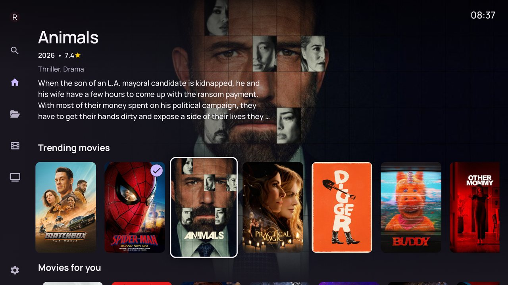
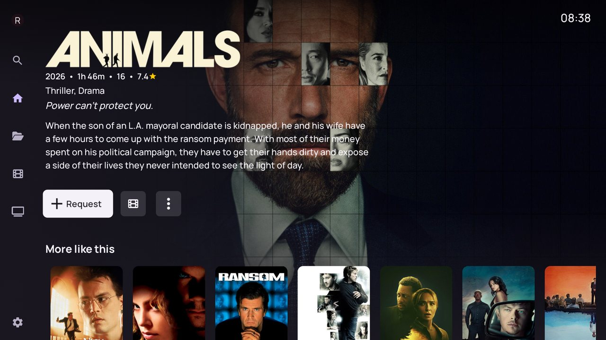
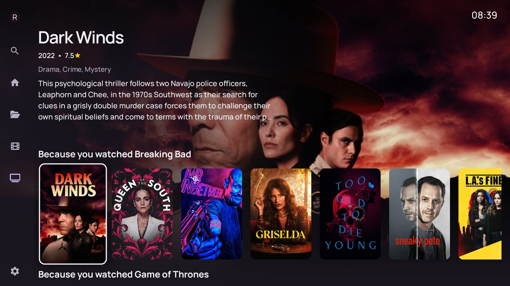
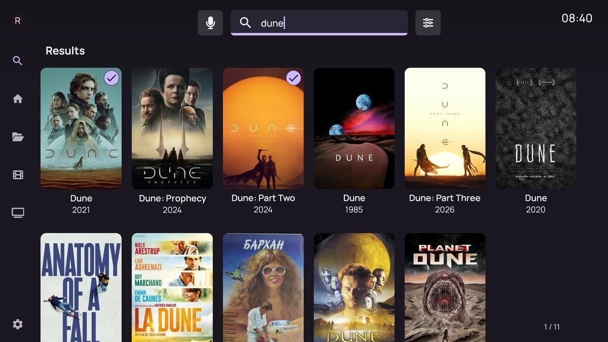
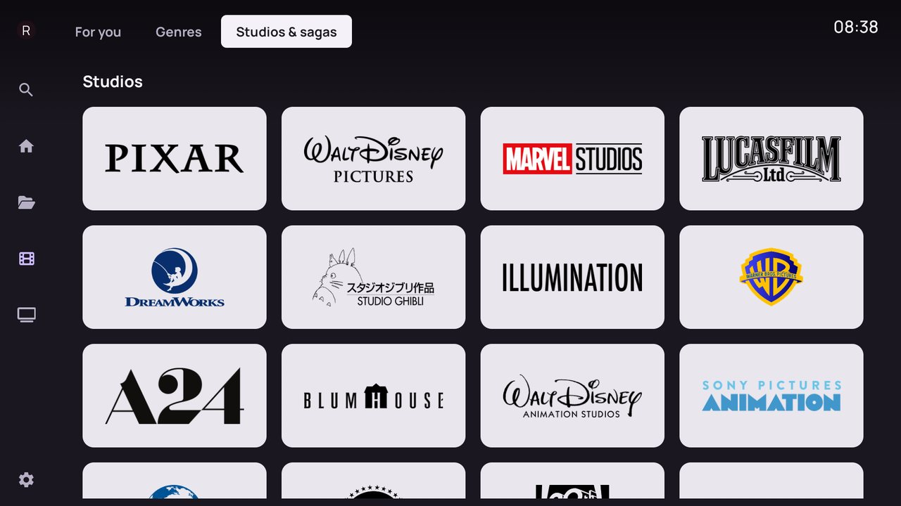
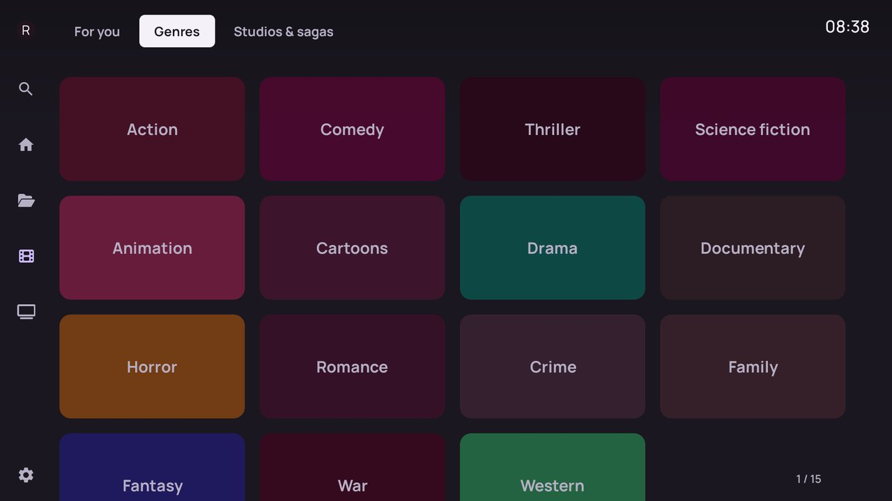

<p align="center"></p>
<h1 align="center">JellyVault</h1>
<p align="center">Tu biblioteca de Jellyfin con una pantalla de inicio de plataforma de streaming en Android TV: descubrimiento con TMDB y solicitudes a Radarr/Sonarr desde el sofá.</p>
<p align="center">
  
  
  
  
  
</p>
<p align="center"><a href="README.md">English</a> · <a href="README.fr.md">Français</a> · <b>Español</b> · <a href="README.de.md">Deutsch</a></p>

> **Solo para Android TV y Fire TV.** JellyVault necesita tu propio servidor [Jellyfin](https://jellyfin.org). El
> descubrimiento con TMDB y las solicitudes a Radarr/Sonarr son opcionales: sin ellos funciona como un cliente de
> Jellyfin sin más.

JellyVault convierte tu biblioteca de Jellyfin en una pantalla de inicio al estilo de las plataformas de streaming:
títulos en tendencia, recomendaciones a partir de lo que has visto, estudios y géneros. Los títulos que aún no tienes
se abren en una página completa, y un botón los envía a Radarr o Sonarr.

**Ayuda:** la [guía de usuario](docs/help/es.md) explica la instalación, la clave de TMDB, Radarr/Sonarr, las
solicitudes, las valoraciones, las actualizaciones y la solución de problemas.



## Qué hace JellyVault

- **Inicio en filas**: continuar viendo, tendencias, *Because you watched…*, *Movies for you*, tu lista de seguimiento
  de TMDB y estantes temáticos.
- **Páginas de descubrimiento** para películas y series: recomendaciones, géneros, estudios y sagas o cadenas, y filas
  de tendencias por plataforma de streaming.
- **Páginas de título a pantalla completa** con reparto, tráiler y *More like this*, y reproducción de la copia que ya
  tienes.
- **Solicitudes**: una película a Radarr, una serie, una temporada o todas las temporadas a Sonarr, con el estado de la
  descarga en la página del título.
- **Búsqueda** en tu biblioteca y en TMDB a la vez.
- **Vinculación de la cuenta de TMDB**: tus valoraciones y tu lista de seguimiento alimentan las recomendaciones y
  marcan como vistos los títulos valorados.
- **Cliente de Jellyfin** heredado de Wholphin: vistas de biblioteca, reproducción con ExoPlayer, subtítulos, TV en
  directo, música, trickplay.
- **Idiomas**: interfaz en inglés y francés; los títulos, sinopsis y géneros de TMDB siguen el idioma de la interfaz.




| | |
|---|---|
|  |  |
| Recomendaciones a partir de lo que has visto | Búsqueda en tu biblioteca y en TMDB (✓ = en tu biblioteca) |
|  |  |
| Estudios y sagas | Géneros |

## Privacidad

Todo se queda en el televisor. Tu clave de TMDB y las direcciones, claves y contraseñas de Radarr/Sonarr se guardan
solo en el dispositivo. JellyVault se comunica con tu servidor Jellyfin, con TMDB, con tus servidores Radarr/Sonarr,
con una lista pública del top 10 semanal y con GitHub para buscar actualizaciones. Sin analíticas: tras un fallo, el
informe solo se envía si lo aceptas, y únicamente a tu propio servidor Jellyfin.

## Instalación

Descarga el APK desde [Releases](https://github.com/romainio/JellyVault/releases) cuando se publique una versión, e instálalo en tu Android TV o Fire
TV (antes, permite la instalación de aplicaciones de orígenes desconocidos). Los ajustes y la sesión se conservan al
actualizar sobre una aplicación firmada con la misma clave.

Requisitos: Android TV o Fire TV con Android 6.0 o posterior, un servidor Jellyfin `10.10.x` o `10.11.x`. Una
[clave de API de TMDB](https://www.themoviedb.org/settings/api) gratuita para el descubrimiento, y Radarr/Sonarr si
quieres hacer solicitudes.

Después sigue la [guía de usuario](docs/help/es.md): inicio de sesión en Jellyfin, clave de TMDB en
*Configuración › TMDB & IMDb ratings*, y las entradas *Radarr* y *Sonarr* de la configuración.

## Limitaciones conocidas

- Las descripciones de los títulos que posees provienen de tu servidor Jellyfin, en el *Preferred metadata language*
  (idioma preferido de los metadatos) configurado para cada biblioteca en el servidor. Los textos de TMDB siguen el
  idioma de la interfaz.
- El descubrimiento usa Francia como región: listas de tendencias y de estrenos, clasificaciones por edades, los
  estantes de "cine francés" y el top 10 semanal.
- Las pantallas específicas de JellyVault solo están traducidas al inglés y al francés. En el resto de idiomas de la
  interfaz, esas pantallas se muestran en inglés.

## Hoja de ruta

- **Versiones en GitHub** con APK firmados y actualizaciones dentro de la aplicación servidas desde GitHub.
- **Región de descubrimiento** según el país del televisor en lugar de Francia.
- **Más idiomas** para las pantallas de JellyVault.

## Compilación

```
./gradlew :app:assembleDefaultDebug
./gradlew :app:testDefaultDebugUnitTest
```

JDK 21 (sirve el JBR incluido en Android Studio) y el SDK de Android. Para incluir una clave de TMDB por defecto en tus
propias compilaciones, añade `tmdb.readToken=<your TMDB read access token>` a `local.properties` (no se versiona:
nunca subas tu token). Consulta [DEVELOPMENT.md](DEVELOPMENT.md) para la estructura del proyecto e
[Intents.md](Intents.md) para la API de intents.

## Comentarios

Los errores y las ideas son bienvenidos en [Issues](https://github.com/romainio/JellyVault/issues). Lee [CONTRIBUTING.md](CONTRIBUTING.md) antes de abrir un pull
request.

## Créditos

- [Wholphin](https://github.com/damontecres/Wholphin) de damontecres: JellyVault nació como un fork suyo y la mayor
  parte del código del cliente de Jellyfin proviene de él. Se aplica su licencia GPL-2.0.
- [Jellyfin](https://jellyfin.org) y la [aplicación oficial de Jellyfin para Android TV](https://github.com/jellyfin/jellyfin-androidtv),
  cuyo código se adaptó para el perfil de reproducción directa del dispositivo.
- [TMDB](https://www.themoviedb.org) por los títulos, imágenes y metadatos. This product uses the TMDB API but is not
  endorsed or certified by TMDB. (Este producto usa la API de TMDB, pero TMDB no lo respalda ni lo certifica.)
- [Radarr](https://radarr.video) y [Sonarr](https://sonarr.tv) para las solicitudes de películas y series.

## Licencia

GPL-2.0, consulta [LICENSE](LICENSE). El código es una modificación de Wholphin de damontecres (GPL-2.0); modificaciones
desde 2026.

Jellyfin, TMDB, Android TV y Fire TV son marcas de sus respectivos propietarios; los nombres, logotipos y
pósteres de las capturas de pantalla pertenecen a sus propietarios. JellyVault es un proyecto independiente, sin
afiliación ni respaldo por parte de ellos.
