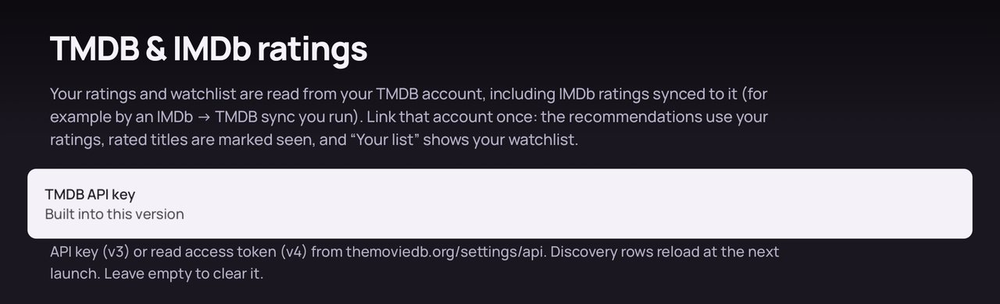
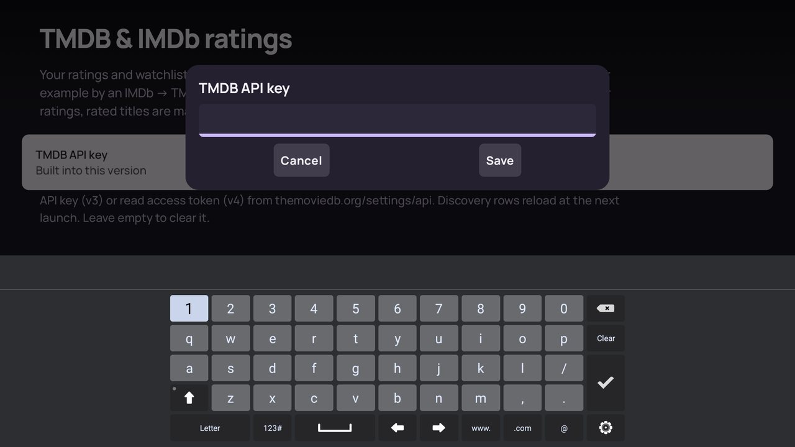
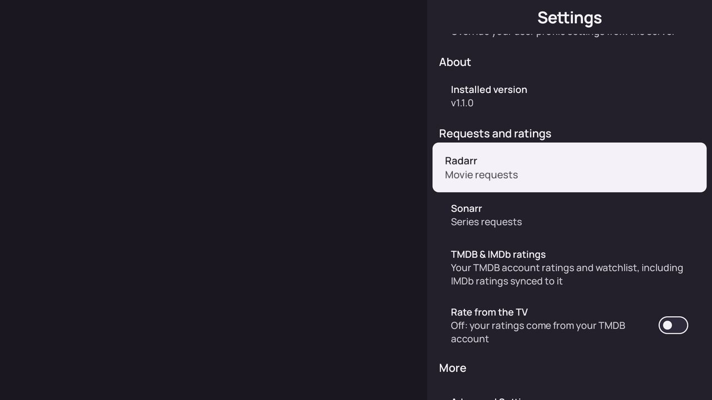
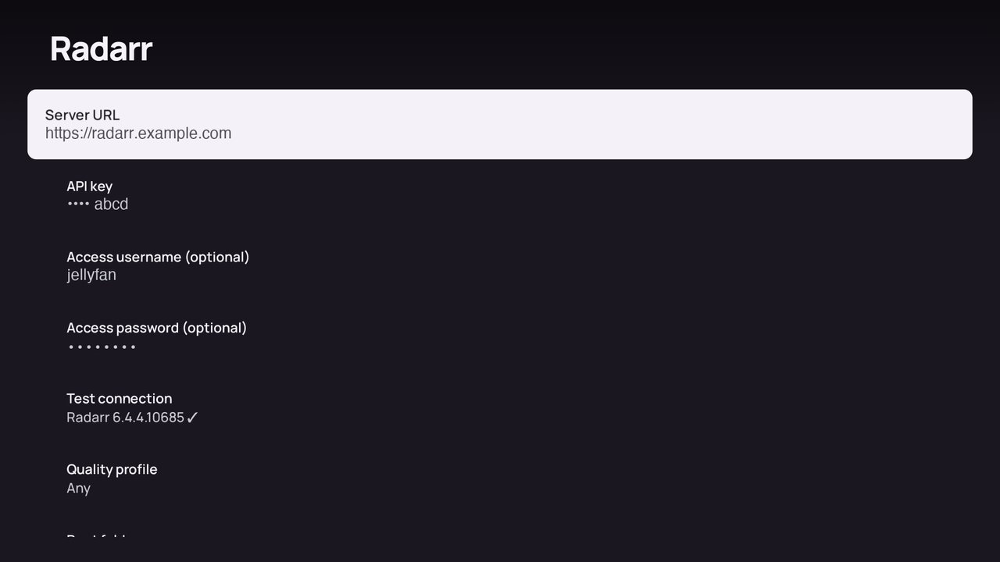
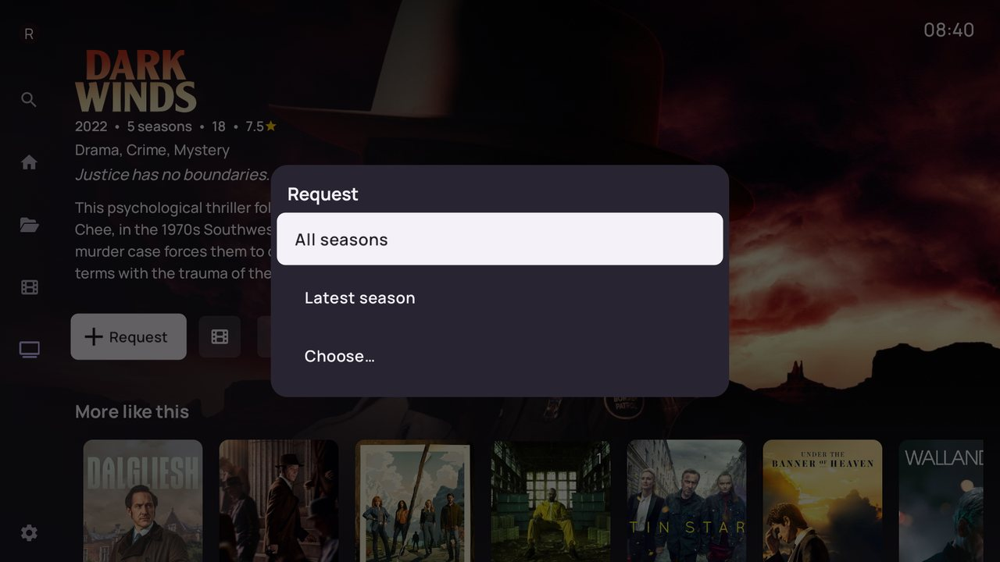

# JellyVault help

**English** · [Français](fr.md) · [Español](es.md) · [Deutsch](de.md) · [Back to the README](../../README.md)

- [1. Install](#1-install)
- [2. Sign in to Jellyfin](#2-sign-in-to-jellyfin)
- [3. Add your TMDB key](#3-add-your-tmdb-key)
- [4. Connect Radarr and Sonarr](#4-connect-radarr-and-sonarr)
- [5. Request a movie or a series](#5-request-a-movie-or-a-series)
- [6. Link your TMDB account (ratings and watchlist)](#6-link-your-tmdb-account-ratings-and-watchlist)
- [7. Language](#7-language)
- [8. Updates](#8-updates)
- [9. Troubleshooting](#9-troubleshooting)

## 1. Install

1. On the TV, allow apps from unknown sources for the app you will install from (for example *Downloader* or a file manager).
2. Download `JellyVault.apk` from the [Releases](https://github.com/romainio/JellyVault/releases) page, or the APK that matches your device (`JellyVault-armeabi-v7a.apk` for most TVs, `JellyVault-arm64-v8a.apk` for recent boxes).
3. Open the file to install it. From a computer you can also run `adb install JellyVault.apk`.

JellyVault needs Android TV or Fire TV with Android 6.0 or later, and a Jellyfin server `10.10.x` or `10.11.x`.

A short glowing logo plays when the app starts, then the home page opens.

## 2. Sign in to Jellyfin

On first launch, add your Jellyfin server address and sign in with your Jellyfin account. JellyVault remembers the server and signs in automatically next time (*Settings › Sign in automatically*).

Without the steps below, JellyVault is already a complete Jellyfin client: libraries, playback, subtitles, live TV and music.

## 3. Add your TMDB key

TMDB powers the discovery rows (trending, genres, studios, recommendations) and the title pages of the movies and series you don't own.

1. Create a free account on [themoviedb.org](https://www.themoviedb.org), then open <https://www.themoviedb.org/settings/api> and request an API key.
2. On the TV, open *Settings › TMDB & IMDb ratings* and select *TMDB API key*.
3. Type the *API key* (32 characters) or the *API read access token* (a long text starting with `eyJ`). Both work.
4. Restart the app: the discovery rows load at the next launch.

The key stays on the TV and is never sent anywhere else than TMDB. A key with a space or a missing character is refused with *This key looks invalid*. To remove the key, save an empty field.

*Built into this version* means the build already carries a key (only for builds made with `tmdb.readToken` in `local.properties`). A key you type replaces it.

On a TV keyboard, validate with the keyboard's ✓ key, then select *Save*.

## 4. Connect Radarr and Sonarr

Requests are optional. They need [Radarr](https://radarr.video) for movies and [Sonarr](https://sonarr.tv) for series.

1. Open *Settings*. The *Requests and ratings* section lists *Radarr* and *Sonarr*.
2. In each one, fill in:
   - **Server URL**: the address you open in a browser, with its base path if there is one, for example `https://radarr.example.com` or `http://192.168.1.10:7878`.
   - **API key**: in Radarr or Sonarr, *Settings › General › Security › API Key*.
   - **Access username / password** (optional): only if Radarr or Sonarr sit behind a reverse proxy with HTTP basic authentication.
3. Select **Test connection**. It shows the Radarr or Sonarr version with ✓ when everything is right.
4. Choose the **Quality profile** and the **Root folder** new requests will use.

## 5. Request a movie or a series

Open any title you don't own, from the home page, a discover page or the search.

- **Movie**: *Request* sends it to Radarr right away.
- **Series**: *Request* asks what to send to Sonarr: *All seasons*, *Latest season* or *Choose…* for specific seasons.

The button then follows the download: *Requested*, *Downloading 42%*, *Available soon*, then *Watch* once the file is in Jellyfin. *Refresh* asks Jellyfin to scan its library when a download finished but the title doesn't show yet. For a series with some seasons already there, the button shows *2/5 seasons · Request more*.

If the button says *Set up Radarr* or *Set up Sonarr*, the service isn't configured yet: selecting it opens its settings.

## 6. Link your TMDB account (ratings and watchlist)

Linking your TMDB account improves the recommendations:

- your ratings feed the *Because you watched…*, *Movies for you* and *Series for you* rows,
- titles you rated are marked as seen,
- your TMDB watchlist appears as *Your list* on the home page.

Open *Settings › TMDB & IMDb ratings › Link my TMDB account*, scan the code with your phone, sign in to TMDB and press *Approve*, then select *Done, it's approved* on the TV. *Unlink* removes the link.

**Rate from the TV** (in *Settings*) adds a *Rate* button on title pages. When it's off, ratings come only from your TMDB account.

**IMDb ratings**: JellyVault reads ratings from TMDB. To use your IMDb ratings, copy them to your TMDB account with an IMDb → TMDB sync tool you run yourself.

## 7. Language

*Settings › User interface language* changes the language of the app. TMDB titles, synopses, genres, logos and trailers follow it.

- The JellyVault screens are translated in English and French. Other languages show English on those screens.
- The descriptions of the titles you own come from your Jellyfin server, in the *Preferred metadata language* of each library. Change it on the server and refresh the library metadata to get them in another language.
- Discovery uses France as its region: trending lists, age ratings and the French shelves.

## 8. Updates

The APK from the Releases page checks GitHub for new versions when it starts and shows *Update available* when there is one. The *About* section of *Settings* also shows whether an update is available. You can turn the automatic check off in *Settings › Advanced Settings › Automatically check for updates*.

Installing a new version over the old one keeps your settings, as long as both are signed with the same key. A build you made yourself (signed with your own key) can't be updated by the Releases APK: uninstall it first, which deletes the app's settings.

## 9. Troubleshooting

**No discovery rows, or "TMDB not configured: add your key in Settings › TMDB & IMDb ratings"**
Add a TMDB key ([step 3](#3-add-your-tmdb-key)), then restart the app.

**Radarr / Sonarr errors**

| Message | What to check |
|---|---|
| *Radarr is unreachable* | The server URL, and that the TV can reach that address |
| *API key refused by Radarr* | The API key |
| *Access refused by the server in front of Radarr* | The access username and password of your reverse proxy |
| *Invalid Radarr settings (URL or key)* | A typo in the URL (for example `htts://`) or in the key |
| *Not found in Sonarr* | Sonarr couldn't find the series, often because TMDB has no TVDB id for it |

**The TV keyboard drops characters or the D-pad can't leave a text field**
Some TV keyboards behave this way. Type slowly, check the field before saving, and validate with the keyboard's ✓ key.

**The screensaver or the "Recently added" channel disappeared after an update**
Choose the JellyVault screensaver again in the Android TV settings, and allow the channel again from the home screen's channel settings.

**Collecting logs for a bug report**
See [DEVELOPMENT.md](../../DEVELOPMENT.md#gathering-app-logs), then [open an issue](https://github.com/romainio/JellyVault/issues) with the logs, the app version (*Settings › Installed version*) and your TV model.
